# Souqna

**Online stores for shops, groceries, restaurants and cafés, built Arabic-first.**

Souqna lets a small business open its own online store in about a minute, at `yourname.souqna.app`.
Each store has its own name, colours, products, languages and currency. Shoppers order in Arabic or
English and pay cash on delivery, and the owner runs everything from a simple admin on their phone or
computer. One platform runs every store, and each store's plan decides which features it gets.

> This repository is a showcase: screenshots, a demo video and a description of how Souqna is built.
> Souqna's source code is private.
>
> **Live demo:** _coming soon_ · **Contact:** _add your profile link_

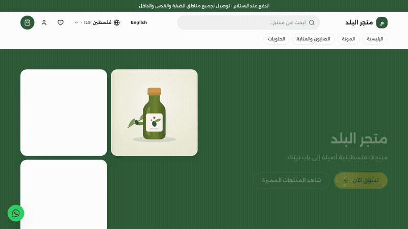

▶ [Watch the demo video (MP4, 32 seconds)](media/souqna-demo.mp4)

## What it does

**For shoppers**
- Stores that read naturally in Arabic (right to left) or English, on phones and desktops
- Categories, search, product options (size, weight…) and live stock
- Cart, wishlist, and checkout with delivery areas and fees, discount codes and cash on delivery
- Prices in the shopper's own currency (shekel, Jordanian dinar, US dollar…)
- Sign-in with a mobile number and a one-time code, saved addresses, order history and tracking
- Order receipts and status updates on WhatsApp

**For store owners**
- Products in Arabic and English, with photos, options, prices and stock
- Orders from "received" to "delivered", with a WhatsApp alert for every new order and one-tap call or WhatsApp to the customer
- Discount codes, and sales reports: sales per day, best sellers and top delivery areas
- A team with roles (owner, manager, staff)
- The store's own name, tagline, colours and contact details

**For the Souqna team**
- Self-serve sign-up: a new store is live in about a minute
- Plans (Free, Basic, Pro, Business) with features and limits, plus exceptions for a single store
- A console to find, pause or reopen any store

## Screenshots

### The stores

| | |
|---|---|
| 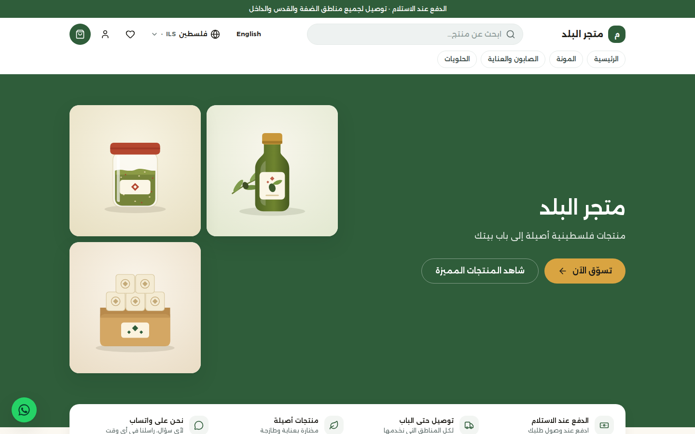 | 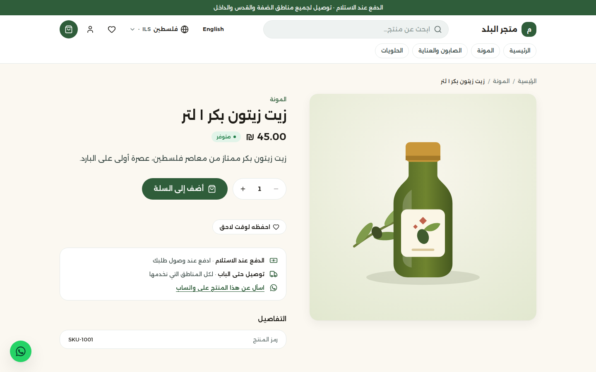 |
| A store's home page, in Arabic | A product page |
| 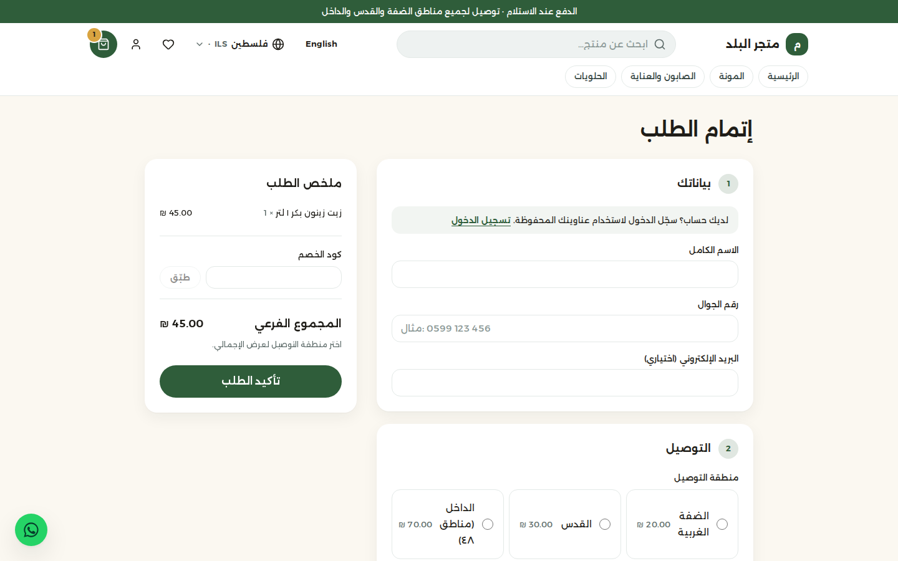 | 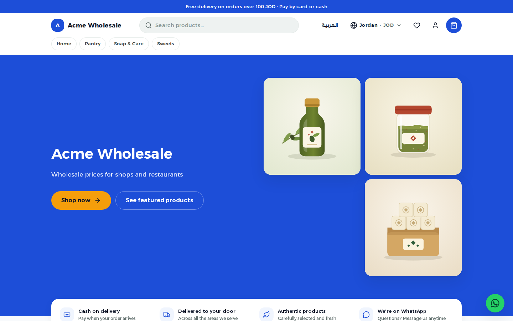 |
| Checkout with delivery areas and cash on delivery | A second store, with its own theme, in English |

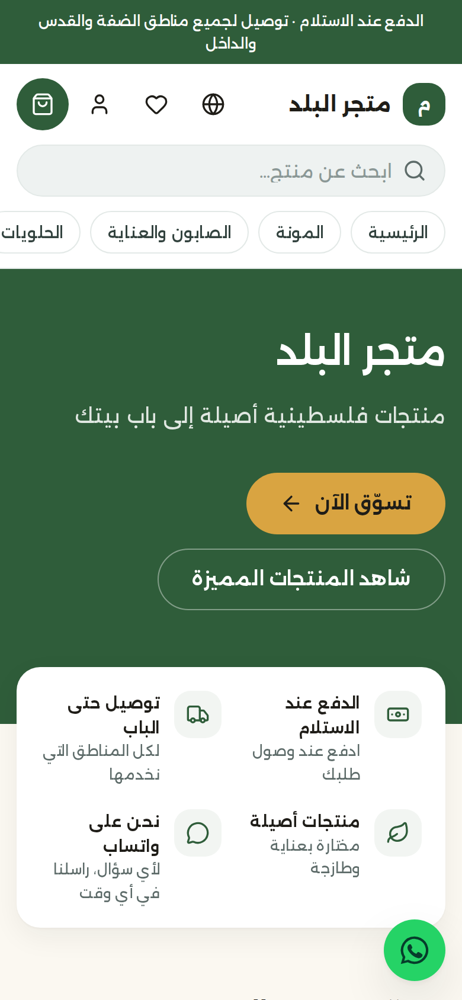

### The store admin

| | |
|---|---|
| 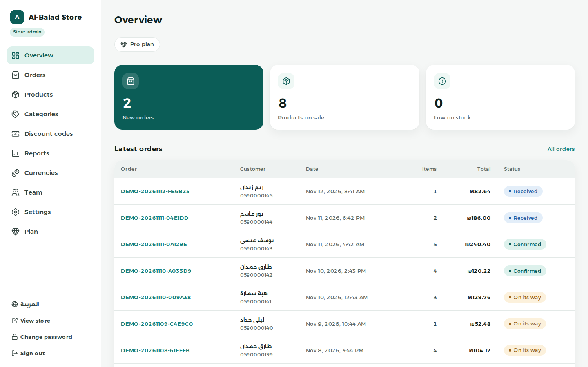 | 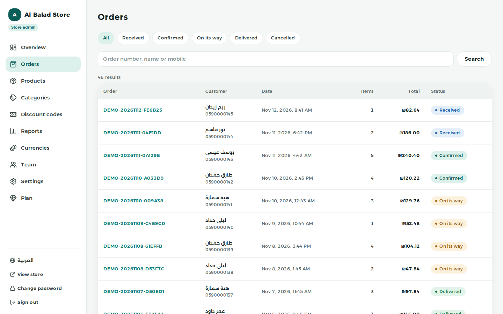 |
| Overview: new orders, products and stock at a glance | Orders, filtered by status and searchable |
| 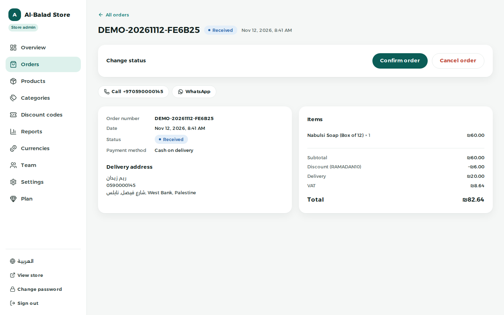 | 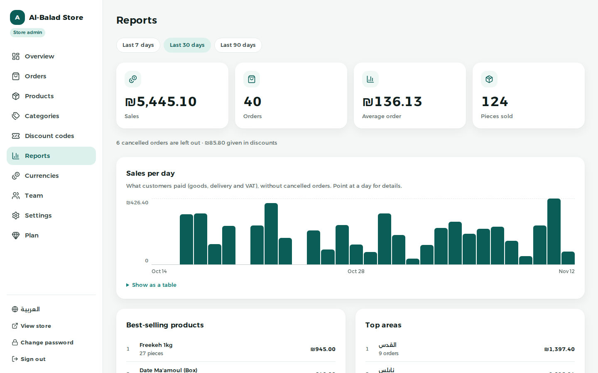 |
| An order: confirm or cancel it, call or WhatsApp the customer | Sales reports for 7, 30 or 90 days |
| 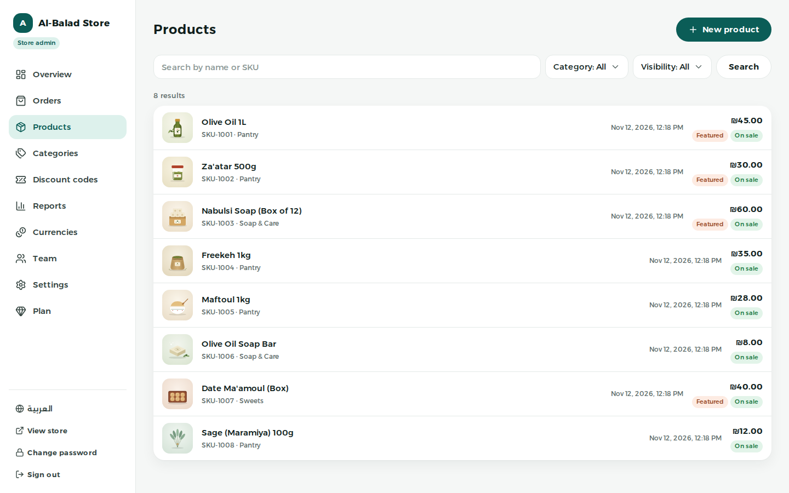 | 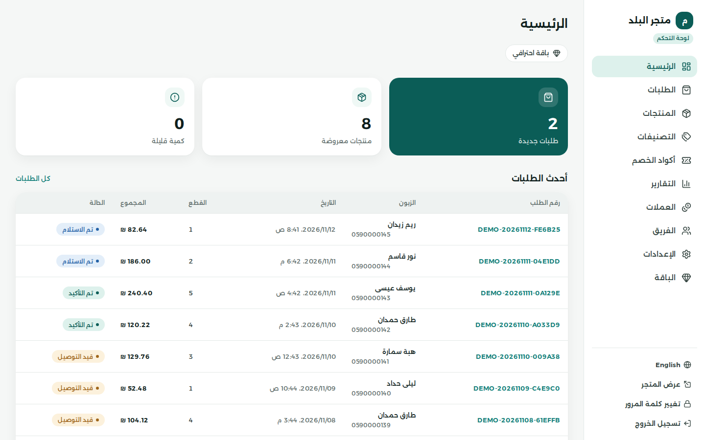 |
| Products with photos, prices and visibility | The same admin in Arabic |

### Souqna's own website and console

| | |
|---|---|
| 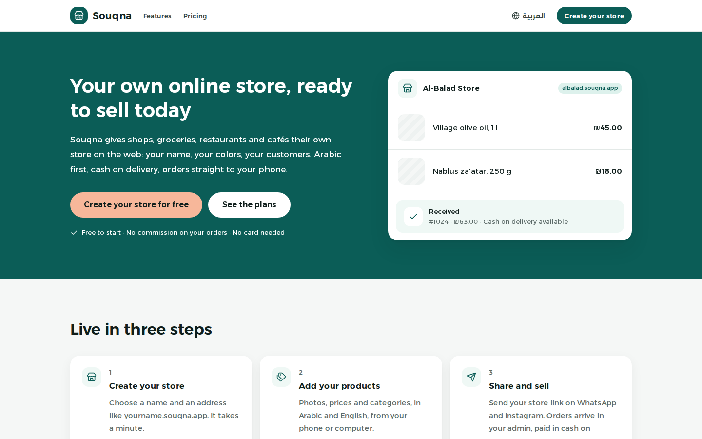 | 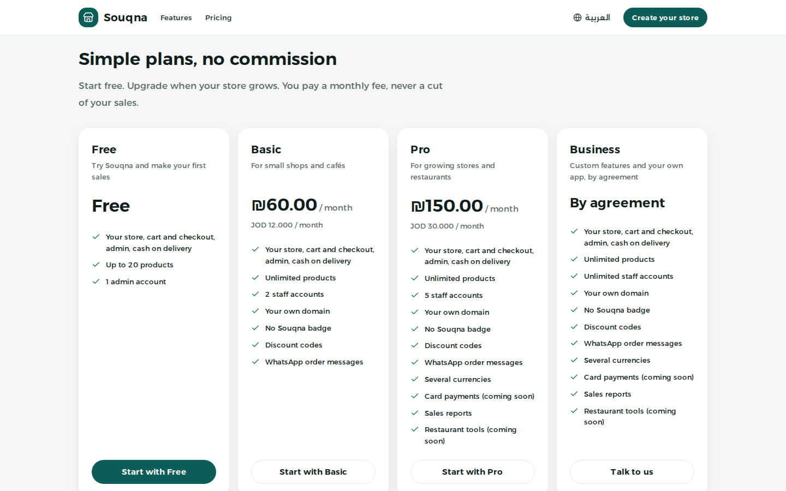 |
| The website where businesses sign up | Plans with no commission on sales |
| 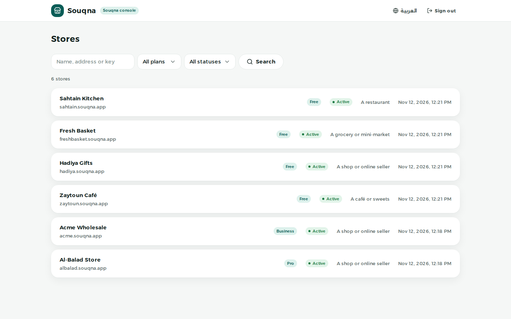 | 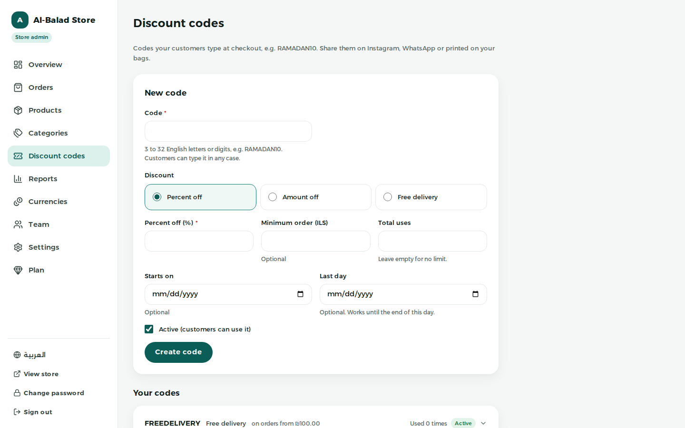 |
| The console for the Souqna team | Discount codes in the store admin |

## How it's built

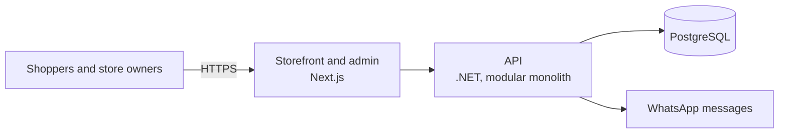

- **One codebase, many stores.** Every store has its own address, settings, theme, languages and
  currency, and each store's data is kept apart from every other store's.
- **Plans decide features.** Features such as multiple currencies or discount codes belong to plans,
  so selling a new feature never means writing code for one customer.
- **Built to be extended.** Payments, delivery pricing and tax are pluggable. Checkout runs as a series
  of named steps, so one store can change or switch off a step without touching the core.
- **Modular.** Catalog, cart, checkout, customers, notifications and the platform are separate modules,
  each with its own database schema.
- **Arabic first.** Right-to-left layouts, Arabic content, local phone numbers and local currencies,
  with English alongside.

**Stack:** .NET 10 · ASP.NET Core · Entity Framework Core · PostgreSQL · Next.js · React · TypeScript ·
Tailwind CSS · Docker · Playwright · GitHub Actions

**Quality:** API tests run against a real PostgreSQL database, browser tests cover desktop and phone
sizes, and CI runs every check on every change.

## Status

Working end to end: stores, catalog, cart, checkout, orders, customer accounts, discount codes,
reports, WhatsApp messages, plans and the console. Preparing for the first production launch.

## Need something like this?

I build web platforms and online stores, from the database to the screens, with Arabic and English
done properly. If you need an online store, a booking or ordering system, or a SaaS product for your
business, get in touch: _add your profile link_.

---

© 2026 Souqna. All rights reserved. This repository contains screenshots, a video and a description
only; no part of the Souqna software is published or licensed here. The stores, people and orders
shown are sample data.
